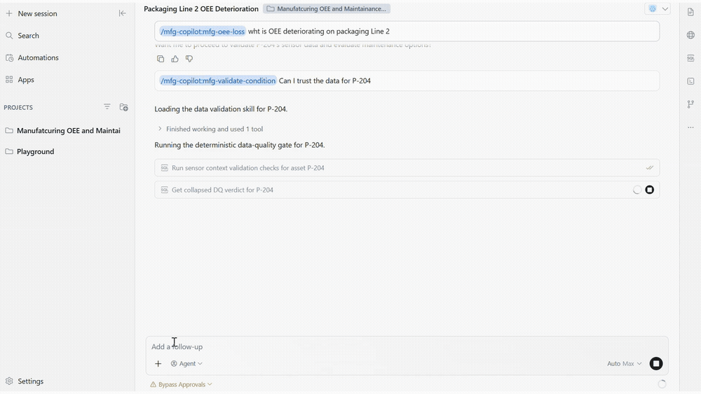
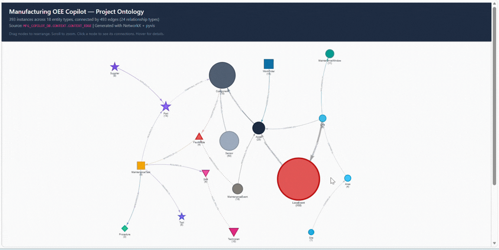
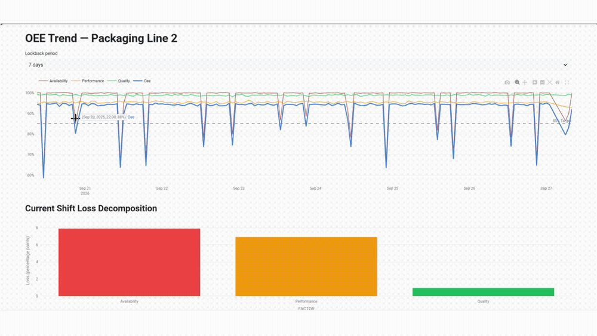
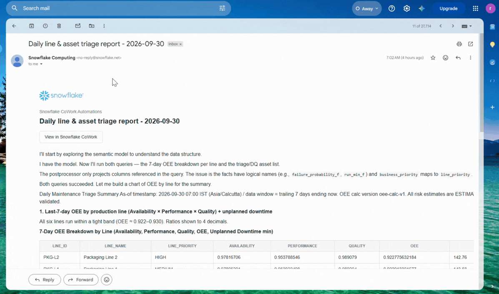
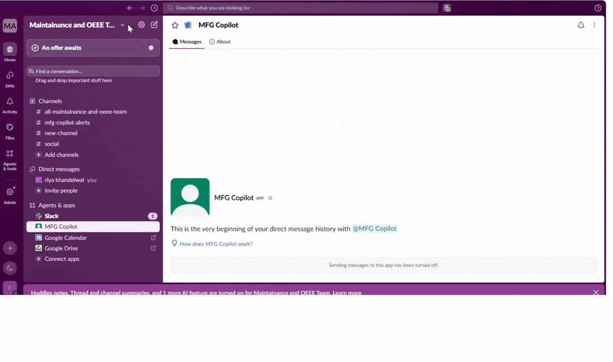
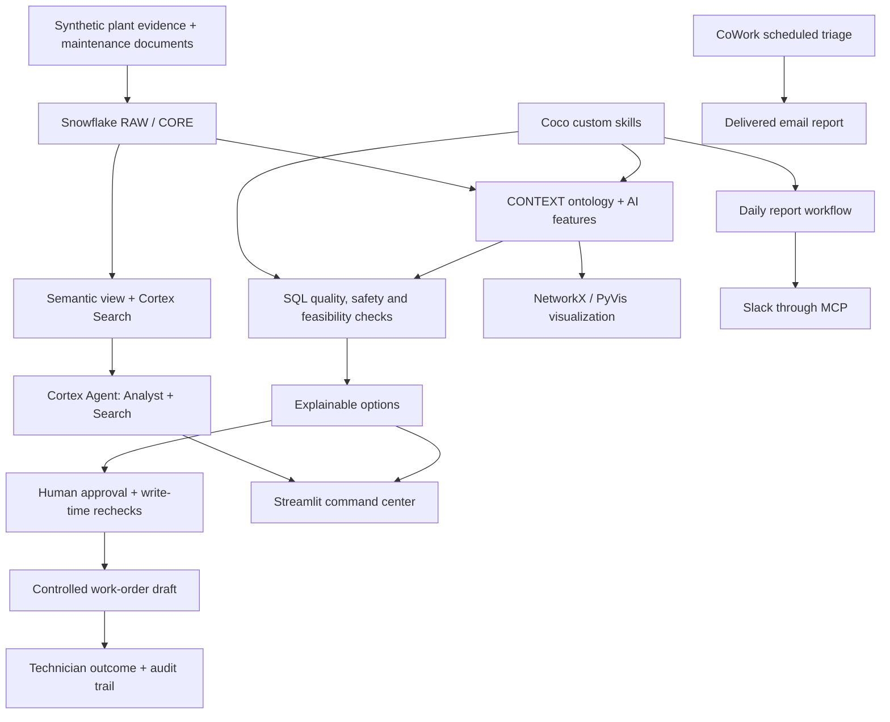

<div align="center">

# Manufacturing OEE & Maintenance Decision Copilot

### From production loss to an explainable maintenance decision.

**Team Data Superheroes · Coco Hackathon 2026**  
Divyansh Saxena · Riya Khandelwal

**Coco skills · Snowflake Cortex · Ontology · Human approval**

[Watch the full demo](docs/assets/demos/full-demo.mp4) · [Explore the walkthrough](#demo-walkthrough) · [How we used Coco](#how-we-used-coco) · [Architecture](#architecture) · [Setup](#setup) · [View the slides](docs/SLIDES.md)

</div>

[](docs/assets/demos/full-demo.mp4)

<p align="center"><strong>▶ Click the image to open the full demo · 5 min 35 sec</strong></p>

## The problem we set out to solve

**When OEE falls, which asset needs attention—and what can the team responsibly do next?**

A supervisor sees lost production. A reliability engineer sees sensor alerts. A planner needs parts, qualified people, approved procedures, and a production window. Those pieces need to come together before a recommendation is useful.

We used **Coco Desktop and CLI** to develop a workflow that connects manufacturing evidence, validates its quality, and compares maintenance actions with explicit reasons. Custom skills make the investigation repeatable; an ontology supplies the connected context; a Streamlit command center makes the results accessible to the team.

> **Prototype scope:** Synthetic single-plant data and illustrative risk rules. Estimates are labeled `SYNTHETIC_DEMO`; business improvement figures in the presentation are targets, not verified production outcomes. The workflow prepares controlled work-order drafts and requires human approval. It does not control equipment or authorize maintenance execution.

## Demo walkthrough

Follow **P-204** from an OEE investigation to a maintenance recommendation. The recorded validation segment shows **all eight quality checks passing**.

### 1. Investigate and validate with Coco skills

Ask why OEE is deteriorating on Packaging Line 2. The OEE skill decomposes availability, performance, and quality, then prioritizes assets for investigation. The validation skill checks whether P-204's sensor evidence can support the next decision.

**What to watch:** the business question, the loss breakdown, the asset priority, and the all-pass validation result.



*Quality-validation excerpt from the supplied demo video. [Watch the complete investigation](docs/assets/demos/full-demo.mp4).* 

**Explore the implementation:** [OEE skill](skills/mfg-oee-loss/SKILL.md) · [Validation skill](skills/mfg-validate-condition/SKILL.md) · [Condition features and quality checks](sql/35_ai_features.sql)

### 2. Connect the evidence through the ontology

The ontology connects **assets → components → potential faults → maintenance tasks → parts, skills, tools, and procedures**. This gives option comparison the context it needs: what a task requires and how those requirements relate to the asset.

The repository contains two complementary visualizations:

- **PyVis interactive graph:** an entity-type overview, with counts, sample instances, and relationship derivations in tooltips.
- **NetworkX snapshot:** the neighborhood around P-204, showing individual connected entities.

Structural relationships, time associations, and confirmed evidence remain distinguishable. A time overlap alone does not establish the cause of a loss.



*Recorded interactive entity-type view: explore relationships and inspect their details. The P-204 instance snapshot is available separately in the source.*

**Explore the implementation:** [Context skill](skills/mfg-asset-context/SKILL.md) · [Graph SQL](sql/40_context_graph.sql) · [Interactive visualization](ontology/ontology_project.py) · [P-204 snapshot](ontology/ontology_snapshot.py)

### 3. Compare feasible maintenance actions

The options skill evaluates actions against data quality, safety, model scope, current procedures, authority, and resource constraints. The demo narrative follows an inspection recommendation and explains why a replacement option is constrained by the available production window.

The decision loop continues through role-appropriate approval, controlled staging, and technician outcome recording. These are implemented workflow stages; the short demo focuses on investigation, validation, context, and comparison.

**Explore the implementation:** [Options skill](skills/mfg-options/SKILL.md) · [Decision functions](sql/60_decision_functions.sql) · [Controlled actions](sql/70_controlled_actions.sql)

### 4. Give the team a shared command center

The **Coco-built Streamlit app** presents OEE, fleet health, maintenance actions, downtime, quality, and an AI copilot in six tabs. Cortex Agent routes metric questions to Cortex Analyst and procedure questions to Cortex Search.

**What to watch:** how the manufacturing evidence becomes accessible through operational views. The source also implements an AI Copilot tab.



*Streamlit excerpt from the supplied demo video.*

**Explore the implementation:** [Streamlit app](streamlit/streamlit_app.py) · [Semantic view](sql/50_semantic_view.sql) · [Cortex Search](sql/45_documents_and_search.sql) · [Cortex Agent](sql/90_cortex_agent.sql)

### 5. Repeat the workflow and share updates

The supplied recordings show two delivery surfaces: a **daily triage email from Snowflake CoWork Automations** and a **plant-health report in Slack**. The email includes line-level OEE and asset/data-quality triage; Slack makes the findings visible in the team's channel.

<details>
<summary><strong>Watch: delivered daily automation email</strong></summary>



*Recorded report delivery. Its schedule and email configuration are not exported in this source archive.*

</details>

<details>
<summary><strong>Watch: Slack plant-health report</strong></summary>



*The GIF shows the Slack destination and delivered report. The MCP connection is represented separately by the packaged integration; the GIF alone does not show the underlying tool call.*

</details>

The packaged Slack reporting queries need alignment with the supplied schema before a fresh deployment; see [setup notes](docs/SETUP.md#slack-and-automation).

**Explore the implementation:** [Daily report skill](plugins/mfg-copilot/skills/slack-daily-report/SKILL.md)

## How we used Coco

| Stage | Coco's contribution | Repository evidence |
|---|---|---|
| **Plan** | Define the manufacturing model, decision contract, ontology, and governance boundaries | [Project rules](AGENTS.md), [decision contract](.cortex-plugin/references/decision-contract.md) |
| **Generate** | Develop reproducible synthetic telemetry and operational events | [Telemetry](sql/20_raw_telemetry.sql), [events](sql/25_core_events.sql) |
| **Build** | Author SQL, semantic definitions, document retrieval, Cortex routing, and the app | [SQL](sql/), [Streamlit](streamlit/streamlit_app.py) |
| **Connect** | Express asset relationships and visualize the decision context | [Ontology](ontology/), [context model](sql/40_context_graph.sql) |
| **Run** | Package domain workflows as reusable skills; coordinate reporting through MCP | [Packaged skills](plugins/mfg-copilot/skills/) |
| **Test** | Exercise deterministic scenarios and a local SQL guardrail test suite | [SQL tests](tests/scenarios.sql), [hook tests](.cortex-plugin/hooks/gate-test.js) |

**Two orchestration layers:** Coco skills coordinate the maintenance workflow. Cortex Agent supplies runtime routing between Analyst and Search. The custom skill sequence and Cortex service routing have distinct responsibilities.

## The governed decision loop

| Phase | Question answered | Skill |
|---|---|---|
| **Detect** | Where is OEE being lost, and which assets need investigation? | `mfg-oee-loss` |
| **Validate** | Does the sensor evidence pass the quality checks? | `mfg-validate-condition` |
| **Connect** | Which faults, tasks, procedures, and resources relate to this asset? | `mfg-asset-context` |
| **Compare** | Which options are feasible, and why are others rejected? | `mfg-options` |
| **Approve** | Have the required people approved a controlled draft? | `mfg-stage-work-order` |
| **Record** | What did the technician find, and what was the outcome? | `mfg-outcome` |

`mfg-copilot` coordinates the sequence. Together, these are **seven domain skills**. `mfg-setup` and `mfg-demo` add deployment and demonstration utilities; `slack-daily-report` brings the packaged plugin to **ten skills**. Additional project-level helpers are separate from this count.

## Architecture



The nine schemas separate source data, business entities, context, AI features, governance, decisions, semantic services, audit, and the app. Coco was used to build and operate this solution; the data services and application execute in Snowflake.

<details>
<summary><strong>View the detailed architecture slide</strong></summary>

[](docs/SLIDES.md)

*The deck includes proposed production integrations and expansion paths beyond the synthetic prototype.*

</details>

## Why the decision can be inspected

- **Deterministic checks:** policy-critical quality, safety, and feasibility results come from SQL functions and procedures.
- **Evidence provenance:** timestamps and relationship derivations help distinguish observations, associations, hypotheses, and confirmed findings.
- **Controlled writes:** approvals, write-time rechecks, and stored procedures govern staging; a draft is not work authorization.
- **Layered enforcement:** database access controls and the project hook serve different purposes. The hook applies to its configured Coco tool matchers; it is not a universal interceptor for every possible SQL client.
- **Auditability:** decisions preserve evidence, alternatives, approvals, and outcomes.

See [safety boundary](.cortex-plugin/references/safety-boundary.md) and [controlled actions](sql/70_controlled_actions.sql).

## Setup

Start with the [deployment and validation guide](docs/SETUP.md). It covers prerequisites, the current archive's path/configuration gaps, skill packaging, ontology generation, and reporting setup.

The supplied deployment scripts target `MFG_COPILOT_DB` and `COMPUTE_WH`. Use a dedicated demo environment: deployment scripts replace objects and reseed synthetic data.

```bash
# From the repository root, after configuring your Snowflake connection:
bash sql/deploy.sh YOUR_CONNECTION

# The default batch deploy does not upload the app source:
snow stage copy streamlit/ '@MFG_COPILOT_DB.APP.STREAMLIT_STAGE' --overwrite -c YOUR_CONNECTION
```

These commands document the supplied code's intended setup. No Snowflake deployment was executed as part of this README review.

## Validation and demo scope

| Evidence | What it covers |
|---|---|
| Recorded validation segment | All eight data-quality checks passing |
| [Scenario assertions](tests/scenarios.sql) | High-risk path, stale telemetry, missing parts, conflicting windows, safety trip, superseded procedure, expired qualification |
| [Scenario configuration](sql/05_demo_clock_and_scenario.sql) | Broader seeded scenario controls and reproducible demo clock |
| [Local hook test](.cortex-plugin/hooks/gate-test.js) | Allowed and blocked sample SQL inputs |

The presence of a scenario or assertion is not proof that its test passed in a deployed account. Production readiness requires deployment validation, live-source mapping, model validation, and site-specific operating controls.

## Presentation

The planned five-minute narration opens with the business problem, solution workflow, and intended impact, then follows the demo above. The supplied full recording runs approximately 5 minutes 35 seconds.

| Business problem | Solution workflow | Intended impact |
|---|---|---|
| [](docs/SLIDES.md) | [](docs/SLIDES.md) | [](docs/SLIDES.md) |

**[Browse all ten slides](docs/SLIDES.md)** · **[View larger slide previews](docs/SLIDES.md)** · **[Read the five-minute narration](demo/SPEAKER_NOTES.md)**

*Impact figures describe intended outcomes. This repository does not establish measured downtime reduction or OEE improvement.*

## Repository map

```text
sql/                         Numbered deployment scripts and deploy.sh
skills/                      Project-level skills and helpers
plugins/mfg-copilot/          Packaged skills and MCP configuration
.cortex-plugin/              Original plugin, hook, and reference contracts
streamlit/                   Command center source
ontology/                    Edge export, interactive graph, static snapshot
documents/maintenance_approved/  Maintenance evidence corpus
tests/                       Snowflake scenario assertions
demo/                        Five-minute speaker notes
docs/                        Setup guide, media guide, slide previews, deck
```

## Team

**Divyansh Saxena · Riya Khandelwal**  
Team Data Superheroes · Coco Hackathon 2026
