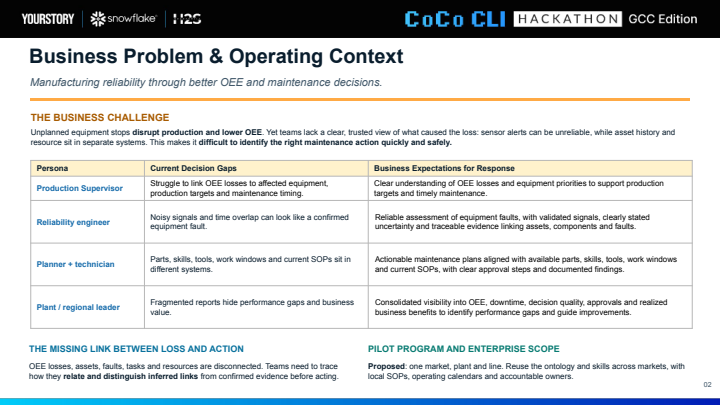
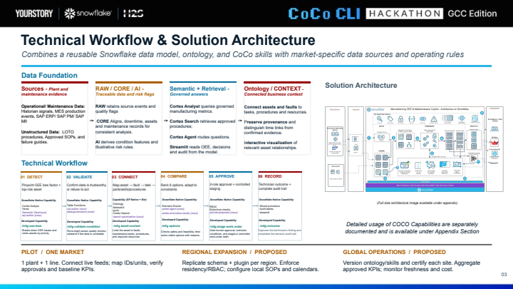
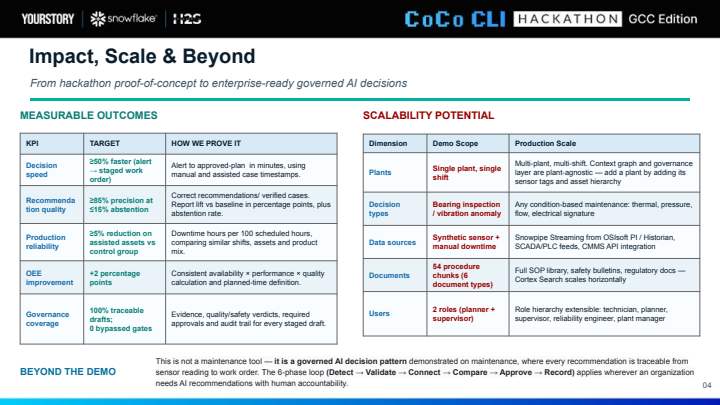
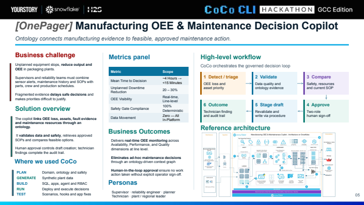
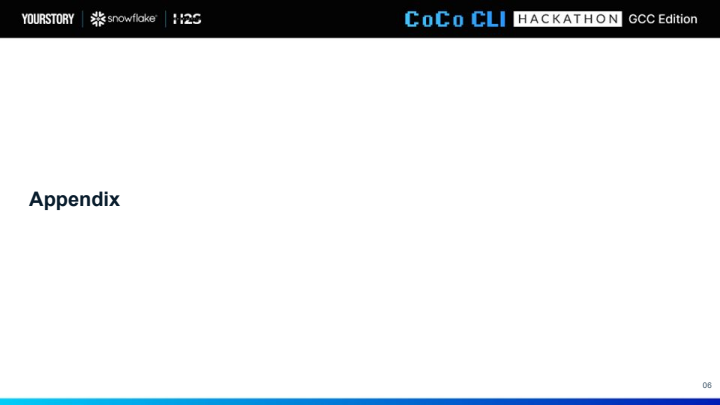
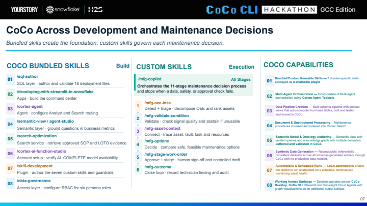
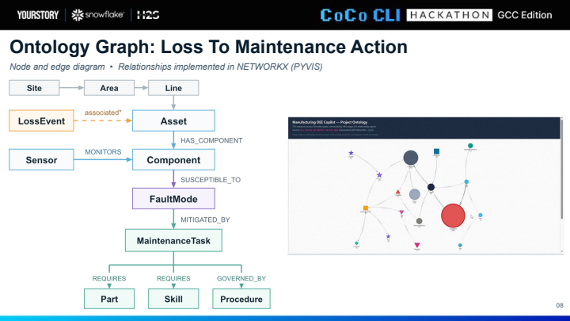
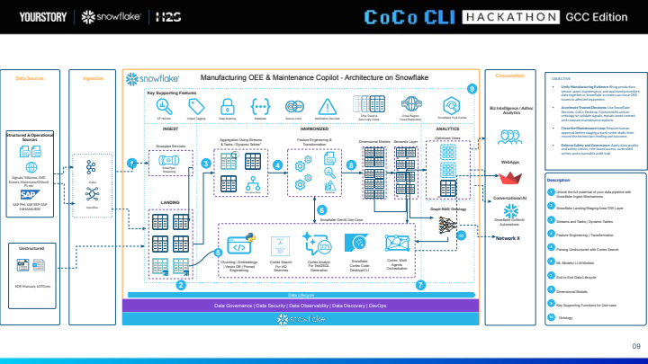
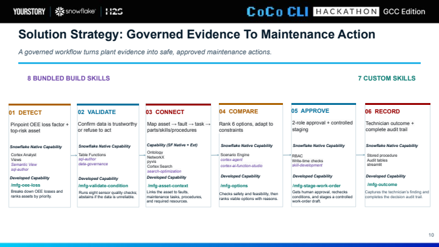

# Presentation slides

Slides preserved from the supplied PDF review. Impact figures are targets, not verified production outcomes.

[Back to the README](../README.md)

## Slide 1: Title

## Slide 2: Problem

## Slide 3: Workflow

## Slide 4: Impact

## Slide 5: One Page Summary

## Slide 6: Appendix

## Slide 7: Coco Capabilities

## Slide 8: Ontology

## Slide 9: Architecture

## Slide 10: Decision Loop

